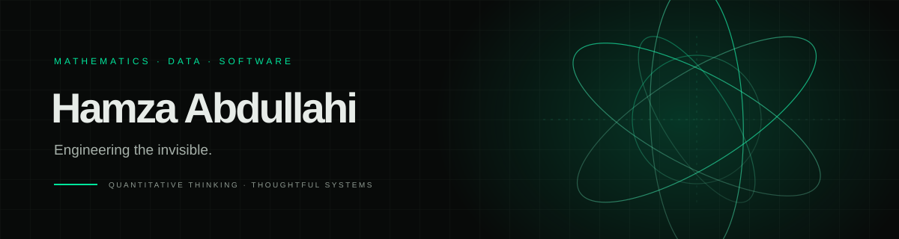

  

  
<strong>Mathematics · Applied Data Science · Financial Engineering · Software Systems</strong>

  
I connect mathematical thinking, data, and software engineering to build systems that make complex things clearer and more useful.

  

    <a href="https://hamzayawa.github.io/minimal-luxury-portfolio/">Portfolio</a> ·
    <a href="https://github.com/hamzayawa?tab=repositories">Projects</a> ·
    <a href="https://www.linkedin.com/in/yawatech/">LinkedIn</a>
  

---

## Selected work

### University Learning Management System

An in-development university platform focused on academic workflows, structured access control, and accountable results management.

`Laravel` · `PHP` · `PostgreSQL` · `RBAC` · `ReBAC`

### Python Smart Downloads Organizer

A Python automation project in development to classify downloaded files, inspect archives safely, prevent duplicate moves, and support recovery through an undo log.

`Python` · `Filesystem automation` · `Testing`

---

## Areas I explore

- **Mathematics:** modeling, abstraction, and the search for structure.
- **Applied data science:** turning data into explanations, decisions, and useful tools.
- **Software systems:** reliable architecture, clear interfaces, and accountable workflows.
- **Financial engineering:** computational approaches to risk, markets, and quantitative problems.

## Current approach

I value clear reasoning, careful engineering, measurable behavior, and interfaces that respect the people using them.

---

  Curiosity is the beginning of structure.

